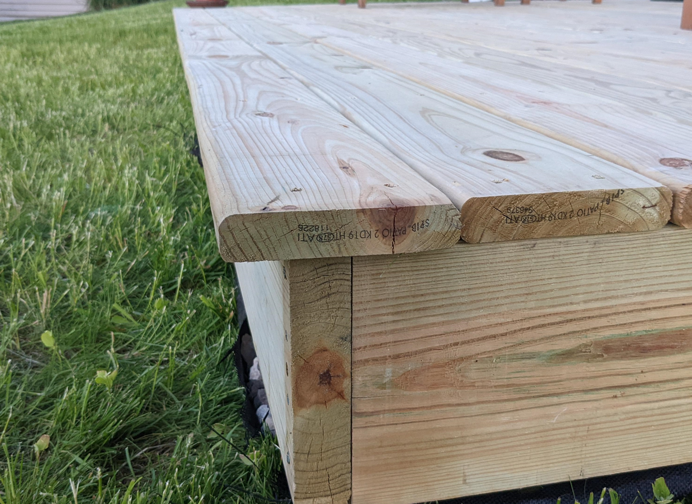
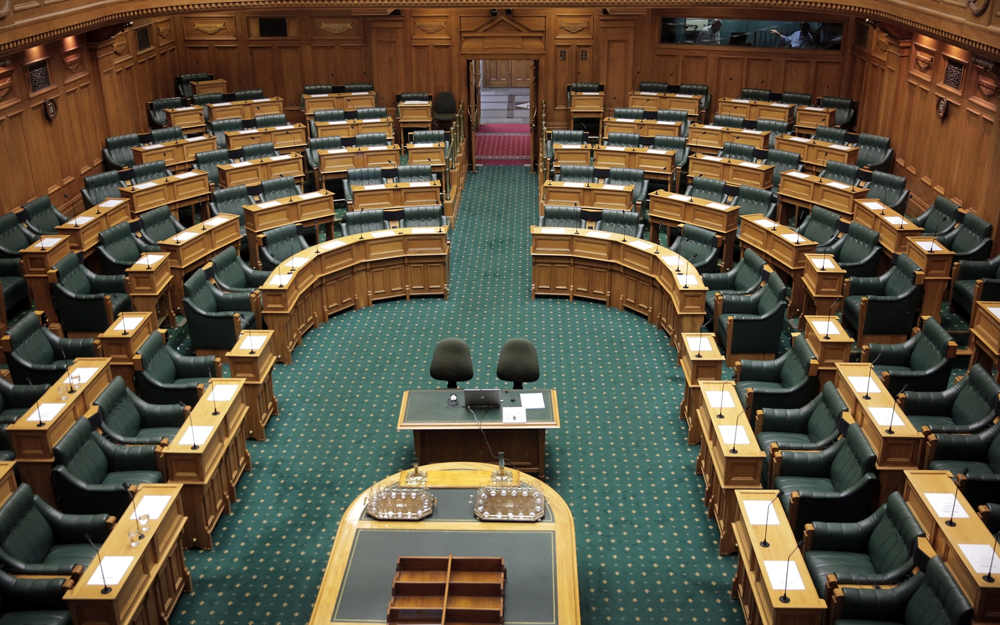

Well, voting season is upon us. I bet you’ve seen the hundreds of promotional signs all around, along with your social media feeds full of ads from all these budding candidates. If you follow the commentary around this election you might have heard about something called “The Overhang” - and it isn't a bit sticking out on a deck.

_More... political than this._

New Zealand uses MMP, Mixed Member Proportional, to elect our government. One of the main goals with MMP is to have a proportional government - the number of seats a political party gets in parliament is directly proportional to the number of votes that party gets. Get 10% of the party vote? You get 10% of the total number of seats in parliament. It's nominally 120 seats, so 10% of the vote would get you 12 MPs. There is some rounding involved, just so we don't have to cut a politician in half to make it exactly proportional.

But there is a snag.

New Zealanders get two votes: the previously mentioned party vote, but also an electorate vote. The electoral vote chooses what individual MP you want to represent your region. We have 71 electorates but 120 seats in parliament - List MPs are what makes up the 49 seat difference. When seats in parliament get allocated each MP that wins an electorate gets in first, then any remaining seats are filled up with List MPs until that party has a correct proportion of seats compared to their party vote total. It’s two ticks! We've had MMP since 1996, and that's the way voting in New Zealand has always worked since then. 

But this time around, the loophole of the overhang is coming to the forefront.

### The Overhang

Say a political party gets 10% of the nationwide party vote, giving them theoretically 12 MPs. But what if that same party has candidates that win 20 electorates? They've got 12 seats by the nationally proportional party vote, but need to have 20 seats to ensure all their electorate winners get in. Those extra 8 candidates are the overhang. The overhang is extra seats on top of the normal 120. In the scenario I mentioned, it would mean parliament would now have 128 seats. And it's not just physical seating that's the issue.

Imagine one party, or one coalition of parties, wins the largest majority of the party vote - 51%, and the opposition side gets 49%. In a non-overhang result, the 51% group would win and form a government. But with that 8 seat overhang, it's different. The 49% party has 8 extra seats! And to form a government, it's not the percentage of the party vote that counts, it's the number of seats. Roughly rounding, the party or group that got 51% of the party vote gets 65 seats, and the opposition that got 49% of the party vote but also got 8 additional overhang gets… 70. And to be a viable government, all you need is more than half of all the seats.

Proportionality is broken! The losing team wins.

_These are the seats. Green Leather!_

It's happening this time around in New Zealand for two main reasons:

Our smaller, so-called minor parties are campaigning successfully to get more of the party vote, but they're not pushing so hard on the electorate vote. To try and exploit this, there are groups actively promoting the overhang strategy. Get the one main party in a coalition to have a huge number of electorate votes, and get other parties in the same coalition bloc to have a stronger concentration of party votes. The result is that the whole coalition gets more representation in parliament than what their party votes alone should proportionately allow.

We've also got a small party that is campaigning for electorate votes only - actively telling voters to NOT give them a party vote. That party is polling less than 1% when it comes to the party vote, meaning any electorate seats they win will instantly be in overhang.

Why does this matter? Well, every seat in overhang diminishes the power of the party vote. Certain people's votes count twice when it comes to the makeup of parliament, and other people's votes are worth a little bit less with each overhang’d win. It corrupts one of the main purposes of our whole political system - for it to be proportional.

But, in the future, it could also be exploited much more. 

A big political party could potentially split itself in two: Party A and Party B. All MPs that are likely to win an electorate seat go into Party A, and all their other candidates go into Party B. When the election is over, Party A and Party B just go into a big happy coalition together.  Every electorate win from Party A would be in overhang - they’d get all the electorate seats there in addition to whatever seats the party vote for Party B would entitle them to. To be clear: in normal circumstances without this party split tactic, all those electorate wins wouldn't give them any additional seats at all.

Taking this to the extreme, we could have a parliament of 191 MPs, with the entire governing coalition getting less than one quarter of the total party votes. That's an extremely farfetched outcome! But in very close political contests an overhang of just one seat can alter what party or what coalition wins.

I think it's a crucial flaw that has the potential to undermine our democratic system.

What are the solutions? In other countries that use a similar voting system there are two main solutions:

* You cannot win an electorate seat unless you also win enough of the party vote to entitle you to a seat. This would make the party vote reliably more proportional, but has the risk of leaving some regions without an electorate MP in parliament at all.

* Another option used in Germany is to add balancing seats. If one party gets an overhang, all other parties get free additional seats in parliament until the party vote proportionality is restored. An overhang of 8 would result in potentially 16 additional MPs total. This has the downside of potentially giving us way, way more MPs - and they're expensive! You've got to feed and wash them, and that adds up.

There are also other experimental solutions:
* Limit the number of overhang seats a party can get to two or even one. Doing this would hopefully mean regions would be less likely to be without a local MP, but it also squashes the idea of actively pushing for a hugely disproportionate government using the overhang.

* You could also make overhang seats count as a different type of MP, one that is more of an advocate for an electoral region in parliament but unable to vote and add count towards a governing coalition.

It sucks. This promotion of tactical voting makes democracy disproportionate and confusing, but under the current rules it is a viable strategy. 

I hope this gets even more coverage in our political discussion, just to make voters more aware of what it is! If anyone has thoughts on this I’d be eager to hear them.

Long live democracy, I guess?
